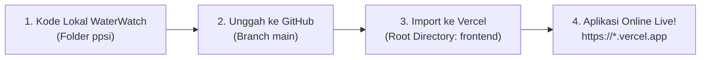

# Panduan Deployment Instan: GitHub + Vercel
## WaterWatch V3 — CCTV Analitik untuk Keamanan Kota
### Versi Simulasi Penuh (Zero Database & 100% Gratis)

Panduan ini disusun khusus untuk deployment **WaterWatch V3** dengan alur kerja paling sederhana dan cepat: **hanya menggunakan GitHub dan Vercel**, tanpa memerlukan database cloud eksternal (PostgreSQL / Neon / Supabase), tanpa Docker, dan tanpa biaya sepeser pun.

---

## Ringkasan Alur Kerja (Hanya 3 Langkah)



---

## Bagian 1: Mengunggah Proyek ke GitHub

Pilih salah satu cara di bawah ini yang paling nyaman bagi Anda:

### Pilihan 1: Otomatis via Skrip Pembantu (Paling Disarankan)
Kami telah menyediakan skrip otomatis di dalam folder proyek Anda:
1. Buka folder proyek `ppsi` di File Explorer.
2. Klik dua kali file **`setup_github_and_push.bat`** (atau jalankan `setup_github_and_push.ps1` di PowerShell).
3. Skrip akan:
   - Memeriksa Git CLI (jika belum ada, skrip menawarkan install resmi otomatis).
   - Menginisialisasi Git dan menyaring file (otomatis mengabaikan `node_modules` dan file build).
   - Meminta Anda memasukkan URL repository GitHub baru Anda.
   - Mengunggah seluruh kode secara instan ke branch `main`.

---

### Pilihan 2: Menggunakan Visual Studio Code (Tanpa Terminal)
Karena VS Code sudah terpasang di komputer Anda:
1. Buka folder `ppsi` di **VS Code** (`File -> Open Folder -> ppsi`).
2. Klik ikon **Source Control** di bilah kiri (atau tekan `Ctrl + Shift + G`).
3. Klik tombol biru **"Publish to GitHub"**.
4. Pilih **"Publish to GitHub public repository"** atau **"private repository"**.
5. VS Code akan otomatis mengunggah seluruh kode ke akun GitHub Anda dalam beberapa detik.

---

### Pilihan 3: Menggunakan Baris Perintah (Git CLI Manual)
Jika Anda terbiasa dengan terminal/PowerShell:
1. Buka terminal di folder `c:\Users\Asus\Downloads\ppsi`.
2. Jalankan perintah berikut:
   ```bash
   # Inisialisasi git dan branch main
   git init
   git branch -M main

   # Tambahkan semua file (kecuali yang diabaikan di .gitignore)
   git add .
   git commit -m "feat: WaterWatch V3 Full-Stack CCTV Analitik"

   # Hubungkan ke repository GitHub Anda (Akun: dharapiolita-lgtm)
   git remote add origin https://github.com/dharapiolita-lgtm/waterwatch.git

   # Unggah ke GitHub
   git push -u origin main
   ```

---

## Bagian 2: Menghubungkan Repository ke Vercel

Setelah kode berada di GitHub, langkah deployment di Vercel hanya memakan waktu sekitar **1 menit**:

1. **Buka Vercel Dashboard:**
   Kunjungi [https://vercel.com/new](https://vercel.com/new) dan masuk menggunakan akun GitHub Anda.

2. **Pilih Repository:**
   Di daftar repository GitHub Anda, cari repository **`waterwatch`**, lalu klik tombol **Import**.

3. **Konfigurasi Root Directory (PENTING!):**
   Pada formulir pengaturan proyek yang muncul:
   - Cari bagian **Root Directory**.
   - Klik tombol **Edit**.
   - Ketik atau pilih folder: **`frontend`**
   - Klik **Continue**.

   *(Hal ini memberitahu Vercel untuk menjalankan Next.js yang berada di dalam folder `frontend`)*.

4. **Environment Variables (Opsional — Sudah Memiliki Nilai Default Aman):**
   Anda **TIDAK PERLU** menyiapkan basis data PostgreSQL eksternal. Aplikasi langsung berjalan dalam mode simulasi in-memory persisten.
   
   Jika Anda ingin menambahkan konfigurasi secara eksplisit di menu *Environment Variables*, Anda cukup mengisi:
   - `SIMULATION_MODE` = `true`
   - `JWT_SECRET` = `waterwatch-super-secret-jwt-key-2026-cctv-secure-dev`
   - `NEXT_PUBLIC_APP_NAME` = `WaterWatch — CCTV Analitik Keamanan Kota`

5. **Klik Tombol "Deploy":**
   Klik tombol hitam besar **Deploy**.
   - Vercel akan otomatis mengunduh dependencies, menjalankan build Next.js, dan menerbitkan sistem ke CDN global.
   - Proses kompilasi memakan waktu $\pm$ 45–60 detik.
   - Selesai! Anda akan mendapatkan domain publik aktif, contohnya:  
     `https://waterwatch-xxxx.vercel.app`

---

## Bagian 3: Panduan Demonstrasi & Pengujian Fitur Live

Setelah website aktif di Vercel, seluruh alur bisnis yang disyaratkan dalam PRD dapat diuji secara langsung:

### Kredensial Pengguna Demo Bawaan
Semua akun menggunakan kata sandi: **`password123`**

| Peran (Role) | Username | Nama Petugas | Hak Akses Utama |
| :--- | :--- | :--- | :--- |
| **Admin** | `admin` | Hendra Setiawan, S.T. | Kelola Pengguna, Kelola Kamera CCTV, Inspeksi Audit Log |
| **Operator** | `operator` | Rian Pratama | Monitoring Live CCTV Grid, Validasi Event, Buat Tiket Insiden, Tutup Insiden |
| **Petugas 1** | `petugas1` | Bripka Ahmad Fauzi | Portal Patroli Mobile, Tangani Insiden Wilayah Barat |
| **Petugas 2** | `petugas2` | Bripda Dimas Permana | Portal Patroli Mobile, Tangani Insiden Wilayah Tengah |
| **Pimpinan** | `pimpinan` | Dr. Ir. Gunawan, M.T. | Dashboard Eksekutif, KPI Waktu Tanggap, Tren Insiden (Read-Only) |

---

### Skenario Pengujian Alur Penuh (End-to-End Walkthrough)

1. **Masuk ke Sistem (Login Multi-Role):**
   - Buka URL Vercel aplikasi.
   - Halaman login dilengkapi tombol *Quick Fill* untuk beralih antar 4 peran dengan 1 klik.
   - Masuk sebagai **`operator`**.

2. **Simulasi Deteksi CCTV Real-Time:**
   - Pada bilah atas (topbar), klik tombol **Simulasikan Event Baru**.
   - Sistem akan menghasilkan deteksi keamanan pada kamera CCTV online secara instan (contoh: *Suspicious Activity* atau *Crowd Gathering* dengan confidence score $\ge 0.60$).

3. **Validasi Event oleh Operator:**
   - Buka menu **Deteksi Event**.
   - Klik event yang baru muncul untuk melihat snapshot kamera dan metrik deteksi.
   - Klik **Validasi VALID**. Event yang sudah divalidasi tidak dapat divalidasi ulang (proteksi duplikasi).

4. **Eskalasi ke Tiket Insiden Resmi:**
   - Dari event yang telah berstatus `VALID`, klik **Eskalasi ke Insiden**.
   - Pilih petugas pelaksana: `Bripka Ahmad Fauzi (petugas1)`.
   - Tiket insiden resmi diterbitkan dengan status awal **`DITUGASKAN`**.

5. **Penanganan Lapangan oleh Petugas Patroli (Mobile-Responsive):**
   - Logout dan login sebagai **`petugas1`**.
   - Buka menu **Portal Petugas** (`/officer/dashboard`).
   - Ikuti alur penanganan SOP wajib 6 tahap:
     $$\mathbf{DITUGASKAN} \longrightarrow \mathbf{DITERIMA} \longrightarrow \mathbf{DI\ LOKASI} \longrightarrow \mathbf{SELESAI}$$
   - Klik tombol **Terima Tugas** (status berubah menjadi `DITERIMA`).
   - Klik tombol **Tiba di Lokasi** (status berubah menjadi `DI LOKASI`).
   - Masukkan catatan tindakan penanganan dan klik **Selesaikan Insiden** (status berubah menjadi `SELESAI`).

6. **Verifikasi Penutupan oleh Operator:**
   - Login kembali sebagai **`operator`**.
   - Buka detail insiden yang telah diselesaikan oleh petugas.
   - Klik **Tutup Tiket Insiden** untuk menyelesaikan siklus SOP ke tahap akhir (**`DITUTUP`**).

7. **Pemeriksaan Laporan oleh Pimpinan Daerah:**
   - Login sebagai **`pimpinan`**.
   - Tinjau metrik eksekutif: total insiden, rata-rata waktu tanggap penanganan, grafik tren kejadian 7 hari, dan sebaran lokasi. Seluruh data disajikan dalam mode aman *Read-Only*.

8. **Pemeriksaan Integritas Audit Trail oleh Admin:**
   - Login sebagai **`admin`**.
   - Buka menu **Audit Log**. Seluruh aktivitas autentikasi, simulasi, validasi operator, penugasan tiket, dan pembaruan lapangan tercatat secara permanen tanpa opsi manipulasi (*insert-only*).

---

## Lembar Hak Cipta & Pengesahan

Setiap halaman aplikasi menyertakan badge pengesahan resmi:
- **Hak Cipta:** `Copyright©2026 by Dhara Piolita dan Dr. Erliyan Redy Susanto, M.Kom.`
- **Afiliasi Kelembagaan:**
  - *Pemerintah Daerah (Pemda) — Smart City Command Center*
  - *Universitas Teknokrat Indonesia — Kampus Sang Juara*

